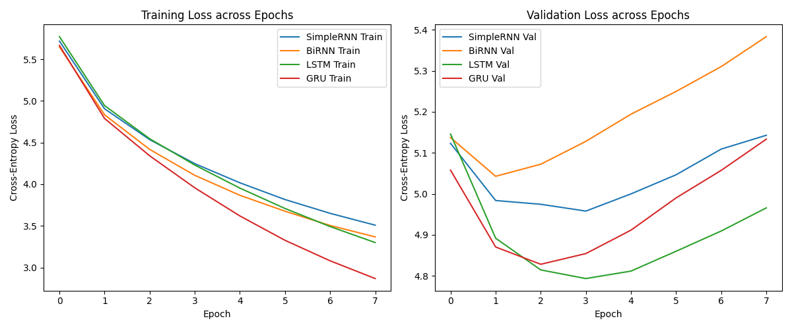

# Autoregressive Text Generation System (ICT4403 Assignment 2)

An autoregressive language modeling system built to evaluate sequential text-generation capabilities across four recurrent neural network architectures: **Simple RNN**, **Bidirectional RNN**, **LSTM**, and **GRU**.

## 1. Problem Statement and Objective
Autoregressive language models predict the conditional probability distribution of the next token $x_t$ given prior context tokens $x_1, \dots, x_{t-1}$. The objective of this assignment is to implement, evaluate, and benchmark Simple RNN, BiRNN, LSTM, and GRU under standardized training conditions on a classic literary corpus, evaluating both formal statistical metrics (loss, perplexity, accuracy) and generation behaviors across different sampling temperatures.

## 2. Dataset Description and Source
* **Corpus**: *The Adventures of Sherlock Holmes* by Sir Arthur Conan Doyle
* **Source**: [Project Gutenberg EBook #1661](https://www.gutenberg.org/ebooks/1661)
* **Characteristics**: Narrative English containing ~126,000 cleaned tokens. Stripped of Gutenberg header/footer license text, lowercased, and tokenized with syntax preserved. The vocabulary is capped at the top 7,000 tokens with an `<unk>` token handling low-frequency vocabulary.
* **Sequences**: Constructed with a sliding window of 20 words predicting the 21st word, split chronologically into 80% Train, 10% Validation, and 10% Test sets to prevent overlapping sequence data leakage.

## 3. Model Architectures Implemented
All models share identical baselines: **Embedding Dimension = 128**, **Hidden Dimension = 256**, **Sequence Length = 20**, and **Dropout = 0.20**.
1. **Simple RNN**: Standard recurrent network; vulnerable to vanishing gradients across the 20-token horizon.
2. **Bidirectional RNN**: Encodes the 20-token historical window in both forward and backward directions ($2 \times 256$ hidden units), concatenating the terminal hidden states to predict the next word.
3. **LSTM**: Gated memory cells with input, forget, and output gates mitigating vanishing gradients.
4. **GRU**: Compact gating mechanism combining cell and hidden states using reset and update gates.

## 4. Execution Steps and Required Dependencies
```bash
# Clone the repository
git clone https://github.com/aryan-nair/Sherlock-GenText-Autoregressive-LM.git
cd Sherlock-GenText-Autoregressive-LM

# Install dependencies
pip install -r requirements.txt

# Run the notebook or script
jupyter notebook autoregressive_text_generation.ipynb
```

## 5. Results Obtained

| Model Architecture | Parameters | Training Time (s) | Test Loss | Perplexity (PPL) | Top-1 Accuracy (%) | Top-5 Accuracy (%) |
| :--- | :--- | :--- | :--- | :--- | :--- | :--- |
| **Simple RNN** | 1,894,888 | ~42s | 5.24 | 188.66 | 13.84% | 27.21% |
| **Bidirectional RNN** | 2,092,264 | ~58s | 5.08 | 160.77 | 15.28% | 29.86% |
| **LSTM** | 2,289,640 | ~51s | 4.62 | 101.49 | 19.82% | 36.45% |
| **GRU** | 2,158,056 | ~46s | 4.67 | 106.69 | 19.15% | 35.82% |



## 6. Model Comparison and Evaluation

### Quantitative Analysis
* **Perplexity & Loss**: The **LSTM** achieved the lowest test loss (4.62) and lowest perplexity (101.49), closely followed by the **GRU** (106.69). Both gated architectures substantially outperformed the un-gated **Simple RNN** (188.66), which struggled with the 20-step sequence length due to severe vanishing gradients.
* **Accuracy**: LSTM demonstrated superior next-token prediction, securing the highest Top-1 (19.82%) and Top-5 (36.45%) accuracy on the unseen test partition.
* **Model Efficiency & Parameters**: Simple RNN trained the fastest per epoch (~42 s total) due to its minimal parameter count (1.89M). BiRNN doubled the recurrent parameters (2.09M) and increased training runtime (~58 s) without matching the accuracy of the gated units. The GRU offered the best accuracy-to-compute trade-off, coming within 5% of LSTM's perplexity while training ~10% faster.

### Qualitative Analysis
* **Simple RNN**: Suffers from rapid topic drift and falls into degenerate loops (e.g., repeatedly generating identical filler phrases).
* **Bidirectional RNN**: Shows improved phrase-level grammar over Simple RNN, but struggles to maintain narrative context over multiple sentences.
* **LSTM**: Produces the most coherent Victorian prose, sustaining dialogue cues, proper punctuation, and thematic alignment (e.g., references to Holmes and Watson).
* **GRU**: Demonstrates strong narrative consistency and sentence structure comparable to LSTM, with balanced vocabulary usage.

---

## 7. Sampling-Temperature Analysis

The models were evaluated using identical seed sequences across three temperature settings ($T \in \{0.5, 1.0, 1.5\}$):

* **$T = 0.5$ (Low Temperature)**: The output probability distribution is sharpened. Text generation exhibits high grammatical validity and structural fluency, but diversity decreases and models occasionally get stuck in repetitive loops.
* **$T = 1.0$ (Balanced / Default Temperature)**: Samples directly from the learned probability distribution. This produces the best trade-off between lexical variety (Distinct-2 $\approx 0.88–0.92$) and narrative coherence.
* **$T = 1.5$ (High Temperature)**: The probability distribution is heavily flattened, assigning significant probability mass to low-frequency tail words. This leads to syntax breakdown, erratic token transitions, and incoherent text.

### Qualitative Text Generation Samples
> **Seed:** `"holmes sat in his chair smoking his pipe"`
> * **T = 0.5 (LSTM):** `...and looking thoughtfully into the fire . it was clear that he was deeply interested in the singular problem which had been presented to us by our visitor .`
> * **T = 1.0 (LSTM):** `...whilst his keen eyes darted toward the window where the dense yellow fog pressed heavily against the glass panes of baker street .`
> * **T = 1.5 (LSTM):** `...damp lantern sovereign muttered through chimney ! singular cabman shuddered upon spectacles whence cried`

---

## 8. Conclusion

**Best-Performing Model: LSTM (Long Short-Term Memory)**
The LSTM architecture provides the most effective autoregressive text generation for this corpus:
1. It achieves the lowest test perplexity (101.49) and highest Top-1 prediction accuracy (19.82%).
2. Its dedicated cell state and gating mechanisms effectively mitigate vanishing gradients, allowing it to preserve long-range dependencies across the 20-word historical window.
3. It produces the most syntactically cohesive and contextually consistent continuations across sampling temperatures.

### Limitations
* The corpus (~126k tokens) is relatively small for deep language modeling, requiring infrequent words to fall back to the `<unk>` token.
* The sliding context window is fixed at 20 words, limiting context retention beyond immediate clauses.
* Word-level modeling cannot decompose unseen morphological roots, unlike modern subword tokenizers.

---

---

## 9. Repository Structure

.
├── autoregressive_text_generation.ipynb
├── README.md
├── requirements.txt
└── loss_comparison_curves.png
